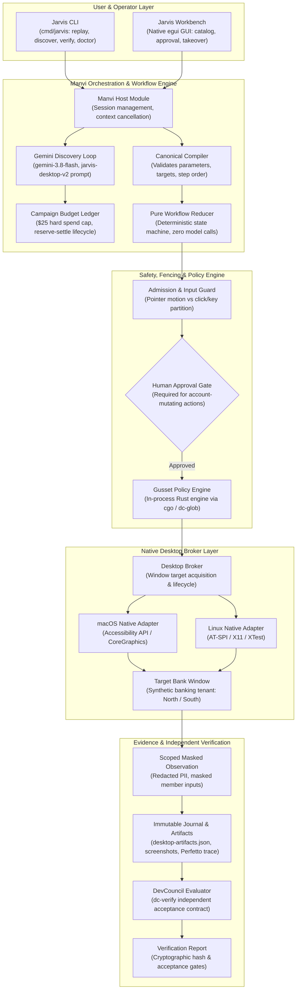
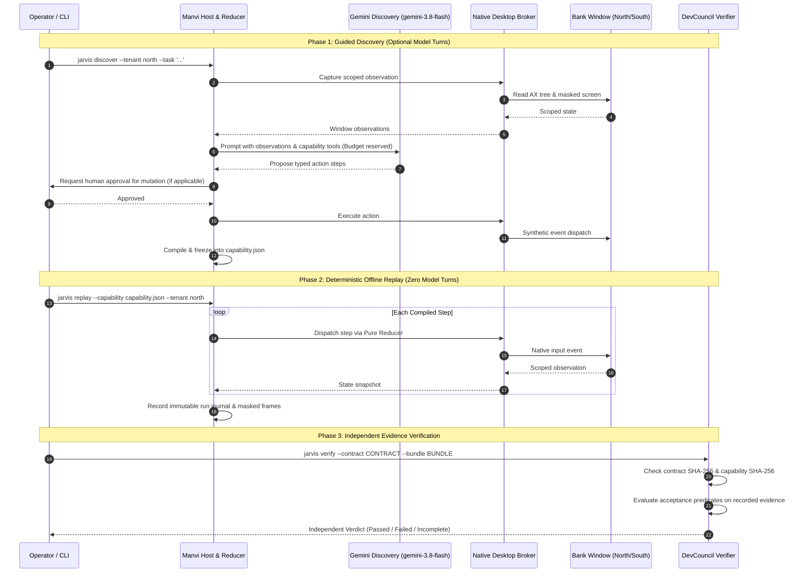

<p align="center">
  
</p>

# Jarvis

[](https://jarvis.vbcr.dev/)
[](LICENSE)

## What Jarvis is

Jarvis is the computer-use agent arm for Manvi and Vani, with more agents to follow. It is the computer-use capability that Manvi-based agents call: an agent decides what to do, and Jarvis observes and operates a native desktop on its behalf, under approval gates and with recorded evidence. This is the owner's direction as of 2026-11-22.

Jarvis discovers desktop capabilities with Gemini, freezes them into typed artifacts, and executes those artifacts through Manvi with zero model decisions. DevCouncil evaluates an independent acceptance contract against the resulting evidence. The native bank has two tenant layouts; the native workbench exposes catalog, editing, execution, approvals, takeover, diagnostics, and evidence inspection.

## How an agent uses Jarvis

An agent reaches Jarvis through its CLI (`jarvis ops`, `jarvis call`, `jarvis replay`, `jarvis discover`, `jarvis verify`) or through the same operations on the Manvi host plane. The contract is in [docs/agent-cli.md](docs/agent-cli.md) (gate, envelopes, yolo mode, exit codes) and [docs/host-jobs.md](docs/host-jobs.md) (background jobs).

### Operations by class

Every `jarvis.*` op the host serves is classified in `internal/app/agent.go` (`agentOps`), default-deny. `agent` ops read, compile or diagnose from disk and run from a one-shot `jarvis call`. `process-scoped` ops address a run or job held in a live process, so a one-shot call is refused with `E_PROCESS_SCOPED`. `human-only` ops approve, act, take over, promote, set a credential, touch a sensitive input or export a run, and are refused with `E_AGENT_REFUSED` unless yolo mode admits them. `TestREADMEOpsTableMatchesAgentOps` fails when this table and `agentOps` disagree.

| Op | Class | Notes |
| --- | --- | --- |
| `jarvis.catalog.list` | agent | params may be inline |
| `jarvis.catalog.history` | agent | params may be inline |
| `jarvis.capability.read` | agent | params may be inline; path params confined to the product root |
| `jarvis.capability.compile` | agent | params may be inline |
| `jarvis.codegen` | agent | params may be inline; path params confined to the product root |
| `jarvis.trace.load` | agent | params may be inline; path params confined to the product root |
| `jarvis.trace.replay` | agent | path params confined to the product root |
| `jarvis.inputs.list-keys` | agent | params may be inline |
| `jarvis.doctor` | agent | background job (`jarvis.job.get`); params may be inline |
| `jarvis.run.start` | process-scoped | - |
| `jarvis.run.list` | process-scoped | - |
| `jarvis.run.get` | process-scoped | - |
| `jarvis.run.control` | process-scoped | - |
| `jarvis.intervention.list` | process-scoped | - |
| `jarvis.anchor.create` | process-scoped | background job (`jarvis.job.get`) |
| `jarvis.frame.get` | process-scoped | background job (`jarvis.job.get`) |
| `jarvis.evidence.verify` | process-scoped | background job (`jarvis.job.get`) |
| `jarvis.job.get` | process-scoped | - |
| `jarvis.discovery.start` | process-scoped | - |
| `jarvis.discovery.get` | process-scoped | - |
| `jarvis.catalog.promote` | human-only | admitted to `jarvis call` in yolo mode; params may be inline |
| `jarvis.inputs.put` | human-only | admitted to `jarvis call` in yolo mode |
| `jarvis.run.assist` | human-only | needs a live run or credential; yolo reaches it through `--events` |
| `jarvis.run.takeover` | human-only | needs a live run or credential; yolo reaches it through `--events` |
| `jarvis.run.handback` | human-only | needs a live run or credential; yolo reaches it through `--events` |
| `jarvis.run.act` | human-only | needs a live run or credential; yolo reaches it through `--events` |
| `jarvis.key.set` | human-only | needs a live run or credential; yolo reaches it through `--events` |
| `jarvis.evidence.export` | human-only | needs a live run or credential; yolo reaches it through `--events` |
| `jarvis.inputs.get` | human-only | refused in every mode: it would print a stored secret into the transcript |

### CLI quickstart

```sh
./build/jarvis ops                                   # every served op with its class
./build/jarvis call jarvis.catalog.list              # one op, one JSON envelope line
./build/jarvis call jarvis.doctor                    # background op: call polls it to the end
./build/jarvis replay --events --capability examples/balance.json --tenant north
./build/jarvis discover --events --provider fixture --tenant north --task '...'
./build/jarvis verify --contract CONTRACT --bundle BUNDLE ...
```

- **Exit codes:** 0 ok; 1 the operation or run failed or verification did not pass; 2 usage error; 3 refused by the agent gate; 4 a run reached an unanswered human gate under `--events` and was cancelled; 5 `--timeout` passed.
- **Async jobs:** `jarvis.doctor`, `jarvis.evidence.verify`, `jarvis.frame.get` and `jarvis.anchor.create` (and `jarvis.evidence.export`) answer on a host connection with `job_id` and `status: "pending"`; poll `jarvis.job.get` until `succeeded`, `failed` or `cancelled` ([docs/host-jobs.md](docs/host-jobs.md)). A one-shot `jarvis call jarvis.doctor` does that polling itself, bounded by `--timeout`.
- **Approvals:** by default an agent is refused approval, takeover, credential and sensitive-input operations, and the interactive CLI accepts `approve` only from a terminal. `replay --events` and `discover --events` stream NDJSON and cancel at the first human gate (exit 4).
- **Yolo mode** (`--yolo` or `JARVIS_AGENT_MODE=yolo`) lets an agent operate Jarvis end to end: it answers gates with NDJSON controls on `--events` stdin, acts, takes over, promotes, and stores inputs. Each agent-operated run is marked (an `operator.json` sidecar, journal actor `agent`, `"operator":"agent"` in the run view), never counts as a human approval, and is refused by `cmd/qualify`.

## Consumers

- **Manvi.** Jarvis imports Manvi's `serve` package and registers its `jarvis.*` ops as a `serve.Module` (`App.Configure` in `internal/app/module.go`), so they are served on the same host plane as Manvi's own ops.
- **Vani.** What the code shows: `profiles/vani.json` and `policies/vani.json` define an inputs catalog of contact fields (given and family name, email, phone, city, country, LinkedIn, GitHub, website), served by `jarvis.inputs.put`, `jarvis.inputs.list-keys` and `jarvis.inputs.get`. A Vani profile has `kind: "inputs"`; the desktop loader refuses that kind, so Vani profiles never drive a desktop window (`internal/app/profile.go`).
- **Open gap.** There is no documented path yet for a Manvi agent to load Jarvis at runtime. Manvi only build-checks Jarvis, through its `scripts/check-consumers.sh`; nothing in this repository shows an agent loading Jarvis as a module.

## System Architecture



## Discovery, Replay & Verification Lifecycle



## Ownership Boundaries

```mermaid
flowchart LR
    subgraph ManviScope["Manvi Ownership"]
        M1["Workflow Compiler & Catalog"]
        M2["Pure Reducer & Runner"]
        M3["Native Desktop Broker Adapters"]
        M4["Journal Privacy & Masking"]
        M5["Per-Attempt Budget Ledger"]
    end

    subgraph DevCouncilScope["DevCouncil Ownership"]
        D1["Evidence Validation Schemas"]
        D2["Independent Acceptance Predicates"]
        D3["dc-evidence / dc-verify Engine"]
    end

    subgraph JarvisScope["Jarvis Ownership"]
        J1["Workbench GUI (egui) & CLI"]
        J2["Tenant Profiles (North & South)"]
        J3["Scenario Contracts & Expectations"]
        J4["Qualification Campaigns & Packaging"]
    end

    JarvisScope --> ManviScope
    JarvisScope --> DevCouncilScope
    ManviScope --> DevCouncilScope
```



Manvi owns the workflow/compiler/catalog, native broker/client, provider integration, journal privacy, cancellation and per-attempt budget ledger. DevCouncil owns evidence validation and acceptance predicates. Jarvis owns bank/workbench composition, reviewed tenant profiles, independent scenario expectations, qualification and packaging. Generic components are developed in their upstream worktrees, not copied here.

## Evidence status

The build recorded in [`evidence/build-verification.json`](evidence/build-verification.json)
(2026-09-09, Manvi `4818dc2`, DevCouncil `4ccadc6`) passed its automated suites; that
run has not been re-recorded at the pins now in `upstream.lock.json`. The campaigns
below record their own executables, not those pins. The fresh macOS campaign on that build completed
**23/40 read-only replays**, with **17 safe suspensions after input-counter changes**;
all 40 independent saved-state checks passed. Those suspensions were attributed to
bare pointer motion by a [controlled experiment](evidence/guard-partition/) and the
admission guard was narrowed to the input that can actually commit a change. The
campaign that followed completed **35/40**, again with all 40 saved-state checks
unchanged, and its four input refusals are attributed by input category — all
genuine human keyboard and pointer-button activity during the run, none of it
pointer motion; a fifth run stopped on an unsatisfied wait predicate. Neither is a
clean stability pass.
Earlier macOS and Linux X11 campaigns each passed 20/20 per tenant on their recorded
executables. First-attempt successes were zero on macOS and one on Linux; retries
are reported separately. The Linux refresh is blocked by a UTM startup crash.
Live Gemini and human-approved account changes remain unqualified; Windows
runtime qualification is deferred by the user. See the exact results in
[`evidence/`](evidence/README.md) and the remaining [acceptance gates](docs/requirements-evidence.md).

## Build, pins and run

Prerequisites: Rust and Cargo with the target platform toolchain, Go 1.27.4, platform accessibility and capture permissions, and the pinned Manvi/DevCouncil checkouts. Upstream revisions are pinned in `upstream.lock.json` (with `go.mod` for Manvi); this README copies no SHAs, so read the lock for the current pins and run `go run ./cmd/dev check-pins` to verify checkouts against it. `cmd/dev` uses Go/Rust only. Platform-specific prerequisites are in `docs/platforms.md`.

A packaged source archive includes `build/upstream/Manvi.bundle`,
`build/upstream/DevCouncil.bundle` and `build/upstream/gusset.bundle`. Restore the exact reviewed revisions without
depending on unpublished remote branches:

```sh
GOWORK=off go run ./cmd/dev bootstrap
go run ./cmd/dev check-pins
go run ./cmd/dev build
go run ./cmd/dev test
```

Bootstrap creates `.local/upstream/` and the ignored Go workspace. An existing
upstream checkout is moved forward to its pin when it is clean, detached and
contained in the pin; one that is dirty, on a branch, or not contained in the
pin is refused and left where it is.

Manvi's CI builds this repository's main against every Manvi change, so an
export Jarvis calls is removed in two pin bumps: Manvi adds the replacement,
Jarvis pins it and migrates, then Manvi removes the old one and Jarvis pins
again. The steps are in Manvi's `docs/COMPUTER_USE_FOUNDATIONS.md`, "Removing or
renaming an export Jarvis calls". Go 1.27.4 must already be installed
for a fully offline bootstrap; automatic Go toolchain acquisition needs network
access. Rust/Go dependency downloads are separate from restoring source bundles.

For existing checkouts at the exact revisions in `upstream.lock.json`:

```sh
go run ./cmd/dev workspace --manvi /path/to/Manvi --devcouncil /path/to/DevCouncil
go run ./cmd/dev build --manvi /path/to/Manvi --devcouncil /path/to/DevCouncil
./build/jarvis doctor
./build/jarvis-workbench --backend ./build/jarvis --root .
```

The generated local `go.work` is ignored, and it is required: Manvi's `go.mod`
replaces DevCouncil and gusset with sibling checkouts, and Go applies those
`replace` lines only inside a workspace, so a `GOWORK=off` build does not
resolve. Build outputs are under `build/`. On Linux and macOS the Go host links the Gusset engine (see below); on Windows, or with `--engine=false`, it builds with `CGO_ENABLED=0`. Other platform FFI is confined to Manvi's Rust native adapters. Qualification builds disable egui inspection controls. Do not treat a Rust cross-check as proof of native execution on that OS.

```sh
./build/jarvis compile --capability examples/balance.json --register
./build/jarvis replay --capability examples/balance.json --tenant north
./build/jarvis replay --capability examples/balance.json --tenant south
./build/jarvis replay --capability examples/balance.json --tenant south --variant renamed-controls
./build/jarvis codegen --capability examples/balance.json --out examples/generated/balance/capability.go
go run ./cmd/qualify --n 20 --out evidence/platform-fresh-40.json
```

The default typed input is the synthetic member M-1001. Use `--inputs scenarios/m1002.inputs.json --contract scenarios/balance-m1002.contract.json` for the second independent expectation. `--pid` attaches an existing bank process; absent `--pid`, Jarvis starts and owns a new bank process (and `--variant renamed-controls` runs the renamed-control build variant on `--tenant south`). Each interactive desktop has one input owner, including cooperating broker processes. Profiles may declare application-specific sensitive parameters; non-bank `kind: "inputs"` profiles (such as `profiles/vani.json`, exposed via `jarvis.inputs.*` stdio operations) supply reusable sensitive inputs without admitting a desktop target or window.

Account-changing replay:

```sh
./build/jarvis replay --capability examples/create-subaccount.json --inputs scenarios/subaccount.inputs.json --contract scenarios/subaccount.contract.json
```

The workflow pauses for a human approval of the exact action, revision, input binding and observed form. In yolo mode an agent may answer instead; that run is recorded as agent-operated and is not a human approval. In the CLI, type `approve` or `deny`; the workbench provides the corresponding reviewed action controls. Approval is consumed once. After uncertain delivery the engine fences input, attempts one bounded same-session observation, and retains `outcome_unknown`. The reconciliation report records observed UI facts without asserting a durable account change. Automatic mutation retry and terminal-run resume remain prohibited.

## Discovery and assisted mode

Enter a Gemini credential in the workbench, or set `GEMINI_API_KEY` in the process environment yourself. Do not put credentials in capabilities, repository configuration or command arguments. Workbench credentials remain in memory. `discover` registers only scoped desktop observation, typed steps, and capability publication; the model receives no shell, filesystem, oracle, or unrelated network tools.

```sh
./build/jarvis discover --tenant north --task 'Look up the member balance, extract USD money, and publish bank.balance.'
./build/jarvis discover --provider fixture --tenant north --task 'Look up the member balance and publish bank.balance.'
./build/jarvis discover --tenant north --resume-session .local/discovery/RUN_ID/session.json --task 'Continue from a fresh scoped observation.'
```

Use `--provider fixture` (optionally `--fixture PATH`, defaulting to the bundled transcript) for offline mock-wire rehearsals labelled `not live`. For live Gemini runs, the initial model is `gemini-3.8-flash`, prompt revision `jarvis-desktop-v2`. A durable $25 campaign ledger reserves the maximum configured input/output charge before every actual HTTP attempt, including transport retries. Unknown/rejected attempts retain reservations; validated usage settles the successful attempt. The conservative rates are $1.50/M input and $7.50/M output including thinking, above the September 2026 promotional rates. This governs this campaign's admission, not unrelated account spending. [Google pricing](https://ai.google.dev/gemini-api/docs/pricing)

Enable `--assisted` or the workbench checkbox for one explicitly requested safe model recovery while paused. The only recovery choices are a unique enabled Back or Dismiss button. Recovery stays paused, records actor `model_recovery`, and requires canonical checkpoint resume. Matching scores never grant approval.

## Evidence and offline replay

Run bundles live in `evidence/private/RUN_ID/`: exact capability and contract bytes, tenant binding, sanitized screenshots and accessibility trees, action/event journal, deterministic trace, Perfetto-compatible trace and the independent verification report. The workbench exports an explicit completed run as a ZIP. Provider-private signed continuation is kept separately under `.local/discovery/`; public journals remove opaque continuation and signatures.

Discovery uses the same durable desktop journal and frame writer as replay. Its `desktop-artifacts.json` hashes the journal and retained frames and explicitly says `not_evaluated`; discovering a proposed capability does not satisfy an independent acceptance contract. An unsuccessful executed discovery step cancels the outer model loop. Run history and program generations keep controls bound to the selected invocation even when discovery advances between microprograms.

The structured editor edits parameters, targets, ordered steps, references and limits through the canonical compiler. Bounded visual anchors can be cropped from the current trusted masked frame for controls without accessibility semantics. Their templates are immutable inline PNGs; protected search regions, ambiguous matches and changed frame geometry are refused. Every visual click requires fresh approval, and visual matches cannot supply extracted text.

```sh
./build/jarvis trace replay --capability evidence/private/RUN_ID/capability.json --trace evidence/private/RUN_ID/trace.json
./build/jarvis verify --contract CONTRACT --bundle BUNDLE --contract-sha256 EXPECTED_CONTRACT_HASH --capability-sha256 EXPECTED_CAPABILITY_HASH --run-id EXPECTED_RUN --session-id EXPECTED_SESSION --epoch 1 [--verifier-sha256 EXPECTED_VERIFIER_HASH] [--policy-sha256 EXPECTED_POLICY_HASH] [--artifacts-root DIR]
```

`trace replay` uses the exported pure workflow reducer and has no desktop backend. `verify` runs out-of-band without initializing the broker or bank and requires independent expected identities (when `--verifier-sha256` or `--policy-sha256` is supplied, `VerifyAgainstHeldOutLock` enforces held-out verifier/contract/capability/policy SHA-256 locks and verdict soundness); it does not read a runner's `passed` flag. Missing prerequisites produce `incomplete`. Hashes identify exact bytes and detect inconsistency, not truthful observation by an untrusted coordinator. A separate qualification-only oracle checks saved bank state and is unavailable to discovery.

## Validation

```sh
go run ./cmd/dev test --manvi /path/to/Manvi --devcouncil /path/to/DevCouncil
DEVC_COUNCIL_EVIDENCE_ROOT=/path/to/DevCouncil go test github.com/bharathvbcr/Manvi/manvi/devcouncil -run TestEvidenceRustCompatibility -count=1
go run ./cmd/qualify --check-boundaries
```

`dev test` executes the complete multi-repo test plan: Jarvis Go suites, Manvi Go packages (`workflow`, `computer`, `budget`, `session`, `tools`, `replay`, `gemini`, `transport`, `agent`, `serve`, `gussetcheck`), desktop and native Cargo workspaces, builds DevCouncil's `./cmd/devcouncil` Go host in a temporary directory outside the checkout (under `GOWORK=off` and the gusset cgo environment) to pass as `DEVCOUNCIL_BIN` for DevCouncil's `dc-verify` suite (`tests/json_contract.rs`), and runs `qualify --check-boundaries`. It runs one Go step and one Cargo step at a time (the intent is to overlap light Go work with a Cargo build, which parallelizes itself; the saving has not been measured), starts nothing new after the first failure and cancels the steps still running, with everything they started (each step runs in its own process group on unix). `cargo-desktop` waits for the Jarvis Go suite, which builds Rust fixtures itself. SIGINT, SIGTERM and SIGHUP cancel the plan. A step that exits 0 but leaves a process holding its output passes, is reported, and has the leftover stopped. All step output goes to stderr. Each output line carries its step's id, and a table of per-step wall time closes the run, pass or fail. `--serial` runs the steps one at a time in plan order, which is the baseline for timing comparisons. The steps no longer read stdin.

### Gusset engine

Manvi's policy gates make every pattern decision on an in-process Rust engine
(DevCouncil's dc-glob on [Gusset](https://github.com/bharathvbcr/gusset)) when
the binary links it, and deny under `path.engine_unavailable` /
`command.engine_unavailable` if it cannot answer. On Linux and macOS `dev build`
links it into `build/jarvis` and runs `build/jarvis gusset-check` (parity and
the panic firewall) before the build counts. A Windows build, or
`--engine=false`, is cgo-off: it decides with Go's fnmatch, `gusset-check`
exits non-zero with "engine is not linked", and `doctor` reports
`"gusset": "not_linked"`. To run the engine's own tests with the race detector:

```sh
go run ./cmd/dev gusset --manvi /path/to/Manvi --devcouncil /path/to/DevCouncil
```

Manvi's `go.mod` replaces DevCouncil and gusset with the siblings of its own
checkout, so gusset must sit next to Manvi (`--gusset` defaults there, and
`bootstrap` restores it from `upstream.lock.json`). The leg prints each
source's revision against its pin first; on working checkouts the proof covers
those checkouts, not the pins. The leg builds the umbrella
archive through DevCouncil's `rust/gusset-engine/cgo-env.sh`, which keys Go's
caches on the archive's hash — Go otherwise relinks a stale archive after a Rust
rebuild — then race-tests `cmd/jarvis` and `internal/app`, runs Manvi's
`gussetcheck` and `serve` suites, and runs `jarvis gusset-check`: CPython
fnmatch parity across the boundary, the batched match-any path, and a real Rust
panic caught at the boundary. The panic line on stderr is that proof running.

Read-only qualification never approves a business change. The denial scenario records denied approval and checks that saved state stayed unchanged. Successful account-changing qualification requires real human approval on every OS/tenant combination. All-success 20/20 results have an approximately 86.1% one-sided 95% exact-binomial lower bound under independence; repeated desktop runs are regression evidence, not proof of independent reliability. [Exact-binomial method](https://itl.nist.gov/div898/software/dataplot/refman2/auxillar/exacbino.htm)

See `REPORT.md` for the design notes and `docs/requirements-evidence.md` for the acceptance matrix.

## License

This project is licensed under the [MIT License](LICENSE).
